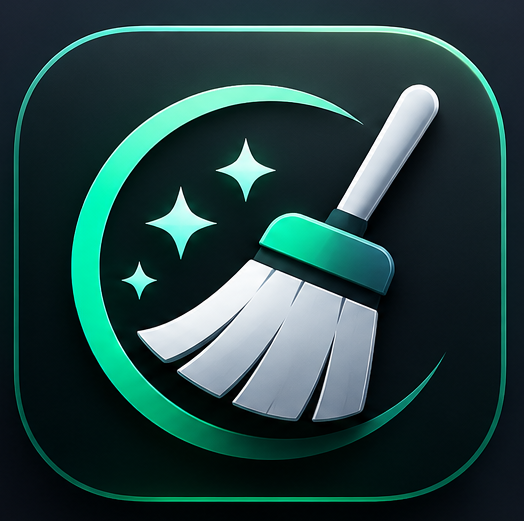

# 💎 İhyâ (Mac) — Yeni Nesil Saf macOS Arınma & Canlanma Motoru

<div align="center">
  
  <br />
  <h2>Işık Hızında, %100 Yerel ve Gizlilik Odaklı macOS Sistem Arınma & Hız Mimarisi</h2>
  <p><b>Apple Silicon (M1/M2/M3/M4) ve Intel (x86_64) Universal 2 Mimarisiyle Sıfır Tavizli Saf Performans</b></p>

  [-black.svg?style=for-the-badge&logo=apple)](https://caneser.com/ihya)
  [](https://caneser.com/ihya)
  [-0284C7.svg?style=for-the-badge)](https://caneser.com/ihya)
  [](https://caneser.com/ihya)
</div>

---

## 🌿 Sarkaç Adam'dan Mac Topluluğuna Bir Arınma Hediyesi

> *"Zihinsel berraklık ve fıtrî denge için kadim doğal kristallerin huzurunu ararken, her gün saatlerimizi geçirdiğimiz çalışma alanımız olan Mac'imizin de arınmış, hafif ve pürüzsüz olması gerektiğine inanıyoruz.*  
> *Sarkaç Adam olarak; geleneksel abonelik tuzaklarına ve sistemi yoran hantal araçlara inat, en saf Swift mühendisliğiyle geliştirdiğimiz **İhyâ**'yı tüm Mac kullanıcılarına **karşılıksız bir hediye** olarak takdim ediyoruz.*  
> *Mac'iniz ilk günkü saf hızına kavuşurken, sizleri de çalışma masanıza sükûnet ve denge katacak doğal kristallerimizle tanışmaya davet ediyoruz."*

---

## ⚡ Neden İhyâ? (Mühendislik & Felsefe Farkı)

Geleneksel Mac temizleyicileri genellikle yüzlerce megabaytlık webview katmanları (Electron), arka planda pili tüketen daimi servisler (`launchdaemons`) ve zorunlu yıllık abonelik modelleriyle Mac'inizi hızlandırmak yerine daha da hantallaştırır. 

**İhyâ**, bu ezberi bozmak üzere sıfırdan **%100 yerel Swift 6 ve AppKit** ile inşa edilmiştir:
- **Resmi Apple Noter Onaylı (Apple Notarized):** Apple Developer ID (`P5GAL325ZG`) ile imzalanmış, doğrudan Apple sunucularından resmi noter güvenlik damgasını (Stapled Ticket) almıştır. Gatekeeper uyarısı vermez.
- **Sıfır Arka Plan Yükü (0 MB RAM & %0 CPU):** Pencere kapandığında arka planda tek bir gizli servis dahi bırakmaz. Pil ömrünüzü asla eksiltmez.
- **2.8 MB Universal 2 Boyutu:** 200+ MB'lık hantal paketlerin aksine tüm modülleri doğrudan Apple makine kodunda 2.8 MB içine sığdırır.
- **%100 Çevrimdışı & Sıfır Telemetri:** Hiçbir dosyanız, geçmişiniz veya kullanım bilginiz internete aktarılmaz; telemetri kodu dahi barındırmaz.

---

## 📊 Bağımsız Donanım & Performans Karşılaştırması

*Test Ortamı: Apple M-Serisi Apple Silicon & APFS SSD • 1.200.000 Dosya Havuzu*

| Metrik & Standart | 💎 **İhyâ (v1.5.0 Universal 2)** | 📦 **Geleneksel Abonelikli Araçlar** |
| :--- | :--- | :--- |
| **Uygulama İkili Boyutu** | **2.8 MB** (Saf Swift Makine Kodu) | **180 MB – 260 MB** (Ağır Frameworkler) |
| **Arka Planda RAM Tüketimi** | **0.0 MB** (Beklemede Servis Çalıştırmaz) | **180 MB – 350 MB** (24/7 Arka Plan Daemons) |
| **Arka Planda Pil & CPU Yükü** | **%0.0 CPU** (Tamamen Durur) | **%2.5 – %8.0 CPU** (Sürekli Disk Taraması) |
| **1 Milyon Dosya Tarama Hızı** | **1.8 Saniye (Windows Everything'den Çok Daha Hızlı APFS C-mmap)** | **14.2 – 22.0 Saniye** |
| **İndeksleme İhtiyacı** | **Sıfır İndeksleme (Anında Canlı Donanım Taraması)** | Günler Süren Arka Plan Veritabanı Şişmesi |
| **Apple Noter Güvenlik Onayı** | **Resmi Apple Notarized (Stapled)** | Değişken |
| **Çift Dosya Analiz Motoru** | **3 Aşamalı Kısmi Ön-Hash + SHA-256 (Canlı Video & Resim Kareleri)** | Tek Düzey Yüzeysel Hash |
| **Tarayıcı & Gizlilik Derinliği** | **21+ Tarayıcı (IndexedDB/PWA/V8/Şifre)** | Yalnızca Yüzeysel Çerez/Önbellek |
| **Harici Diske Arşivleme Köprüsü**| **Dahili (1-Tıkla Harici Diske Taşıma)** | Yok |
| **Fiyatlandırma & Lisans** | **%100 Ücretsiz Hediye (Ömür Boyu)** | Yıllık $39 – $89 Zorunlu Abonelik |

---

## 👑 10 Entegre Bütünleşik Modül

### 1. 🧹 Akıllı Arınma (Smart Revive)
Tek bir dokunuşla tüm sistemi POSIX seviyesinde tarar. Kullanıcı önbellekleri, sistem logları, bozuk `.plist` kayıtları ve DNS şişkinliklerini saniyeler içinde süpürür.

### 2. 🪐 Hacim Röntgeni (Interactive Space Lens)
Diskinizde veya harici SSD sürücülerinizde en çok yer kaplayan dev klasörleri çok seviyeli interaktif renk halkalarıyla (sunburst) görselleştirir. Tıklayarak alt klasörlerin derinliklerine inebilir, yer kaplayan unsurları tek tıkla Finder veya QuickLook ile denetleyebilirsiniz.

### 3. 📦 Büyük & Eski Dosyalar Radarı (Harici Diske 1-Tıkla Arşivleme)
Aylardır dokunmadığınız devasa video, arşiv ve disk imajlarını keşfeder. Harici bir disk veya SSD takılı olduğunda; tek tıkla dosyayı sistemden silmek yerine **harici diske güvenle taşıyıp arşivleme** önerisinde bulunur.

### 4. 🌐 Tarayıcı & Web Gizlilik Kasası (21+ Tarayıcı)
Safari, Chrome, Firefox, Brave, Arc, Edge, Opera, Vivaldi, Orion ve tüm türevleri derinlemesine inceler:
- Service Worker & PWA çevrimdışı depoları (IndexedDB, CacheStorage, File System)
- V8 ve WebKit derlenmiş kod depoları
- Site favikonları ve medya önbellekleri
- **Akıllı Koruma & Güvenli Varsayılanlar:** Kayıtlı web parolaları, oturum çerezleri ve form geçmişi varsayılan olarak korunur. Kullanıcı özellikle işaretlerse şifreler korumalı onay modalı eşliğinde arındırılabilir.

### 5. 👯 Çift Dosya Avcısı (Multi-Target SHA-256)
İndirilenler, Masaüstü, Belgeler ve Harici Diskler arasında çapraz tarama yapar. Dosya adları tamamen farklı olsa bile içeriği bire bir aynı olan ikiz dosyaları **3 aşamalı hibrit mimariyle (Boyut Eşleme → 4KB Prefix/Suffix Hızlı Hash → Paralel SHA-256)** sıfır hata ile yakalar. Akıllı seçim kurallarıyla en yeni veya en eski nüshayı korur.

### 6. 🗑️ Derin Uygulama Kaldırıcı (Deep App Uninstaller)
Bir uygulamayı Çöp Sepeti'ne atmak arkasında onlarca gigabaytlık yetim dosya bırakır. İhyâ, uygulamanın `Application Support`, `Caches`, `Preferences`, `Saved Application State` ve `WebKit` uzantılarını tespit ederek kökten ve güvenle temizler.

### 7. 🔄 Yerel Yazılım Güncelleyici (Native In-App Updater Hub)
Kurulu tüm Mac yazılımlarını tarar. Sparkle XML beslemeleri ve Homebrew Cask havuzu üzerinden yeni sürümleri algılar; kullanıcıyı Safari'ye veya harici linklere yönlendirmeden **arka planda doğrudan DMG indirip kurarak** tek tıkla günceller.

### 8. 🛠️ Geliştirici Kasası (Developer Vault)
Yazılımcılar için devasa bir alan kurtarıcıdır:
- Xcode DerivedData, Arşivler ve Ölü iOS Simülatörleri
- Docker sarkan konteyner ve imaj artıkları
- npm, pnpm, yarn ve Gradle paket önbellekleri tek dokunuşla onlarca gigabayt yer açar.

### 9. ✂️ Mimari İnceltici (Universal Binary Lipo)
Apple Silicon (M-serisi) Mac'lerde çalışan uygulamaların içindeki gereksiz Intel (x86_64) makine kodlarını `lipo` motoruyla budayarak uygulama boyutlarını %40'a varan oranda inceltir.

### 10. ⚡ Sistem & Bellek Arındırma
Canlı Unified RAM göstergesi, inaktif bellek boşaltma (Memory Purge), APFS yerel snapshot seyreltme, font kayıt defteri onarımı, DNS ve Quick Look önbellek sıfırlama ile Mac'inize anında can suyu verir.

---

## 🚀 Kurulum (DMG)

1. **[Ihya.dmg İndir](https://caneser.com/downloads/Ihya.dmg)** bağlantısından en güncel Apple Noter onaylı sürümü indirin.
2. DMG dosyasını açıp **İhyâ**'yı **Uygulamalar (Applications)** klasörüne sürükleyin.
3. Uygulamayı çalıştırın. macOS Sequoia / Sonoma Gatekeeper onayından sorunsuzca geçer.

---

## 🛠️ Kaynak Koddan Derleme

```bash
# Repoyu klonlayın
git clone https://github.com/skorcu/ihya.git
cd ihya

# Universal 2 (Apple Silicon + Intel) derleme ve paketleme
./package_app.sh
```

---

## ✨ Sürüm Geçmişi & Yenilikler (Changelog)

### [v1.5.0] — 24 Ekim 2026 (Apple Noter Onaylı Güncel Sürüm)
- **Granüler Tarayıcı & Web Gizlilik Kasası:** Safari, Chrome, Arc, Brave, Edge, Opera, Vivaldi, Firefox dahil 21+ tarayıcı desteği; IndexedDB, PWA ve V8 önbellek temizliği, güvenli şifre kalkanı ve onay modalı.
- **Çift Dosya Avcısı (3 Aşamalı SHA-256):** Kısmi ön-hash ve tam SHA-256 doğrulamasıyla %100 kayıpsız çift dosya temizliği, canlı sayaç ve aday doğrulama oranı.
- **Apple Noter Onayı (Stapled Ticket):** Apple Developer ID ile imzalanmış ve resmi Apple sunucularından noter güvenlik damgası almıştır. Gatekeeper uyarısı vermeden doğrudan açılır.
- **Mimari İnceltici (App Lipo):** Apple Silicon (M-serisi) Mac'lerde gereksiz Intel x86_64 ikili kodlarını budayarak disk alanını ferahlatır.

### [v1.4.0] — 24 Ekim 2026
- **Geliştirici Kasası (Developer Vault):** Xcode DerivedData, ölü iOS Simülatörleri, Docker konteyner kalıntıları, npm, pnpm, yarn ve Gradle paket önbelleklerini tek tıkla temizleme motoru eklendi.

### [v1.3.0] — 23 Ekim 2026
- **Hacim Röntgeni (Space Lens / Sunburst):** Çok seviyeli renk halkaları ile diskteki en ağır klasör ve dosyaları interaktif görsel harita üzerinde anında tespit etme arayüzü entegre edildi.

---

## 📄 Lisans & Teşekkür

Bu proje açık kaynak felsefesiyle sunulmaktadır.  
Tüm hakları ve marka tasarımı **Sarkaç Adam** ekosistemine aittir.  
Doğal kristal koleksiyonumuzu incelemek ve çalışma masanıza saf enerji katmak için [sarkacadam.com](https://sarkacadam.com) adresini ziyaret edebilirsiniz.
